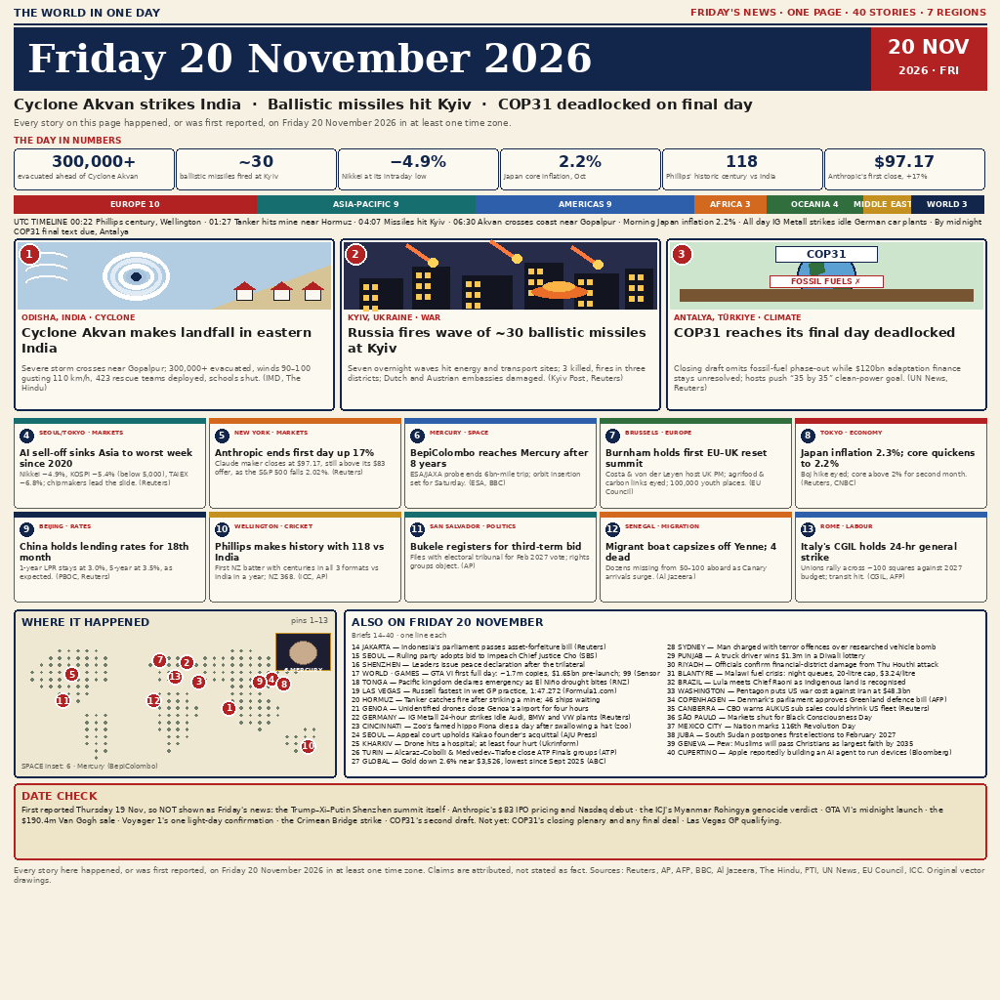

# news-image-20261120 — Friday 20 November 2026 in one image

[](https://make.fun/bounty/news-image-20261120)
[](https://make.fun/bounty/news-image-20261120)
[](https://make.fun/bounty/news-image-20261120)

A one-page broadsheet that sums up the world news of Friday 20 November 2026
in a single 1024×1024 image: 40 stories, 7 regions, 3 drawn lead cards
(Cyclone Akvan in India, ballistic missiles on Kyiv, COP31's deadlocked
final day), cards 4–13, a dotted world map with pins 1–13 and a Mercury
inset, briefs 14–40, a numbers strip, a UTC timeline, and a DATE CHECK
footer separating Friday's news from Thursday's.

Entry for the [make.fun](https://make.fun) bounty
[news-image-20261120](https://make.fun/bounty/news-image-20261120).

## Run

```sh
python3 main.py
```

Writes the image to `/output/entry.png` (or `$MAKEFUN_OUTPUT_DIR/entry.png`).
No network, deterministic — two runs write identical bytes.
PNG, 1024×1024, under 1 MiB.


